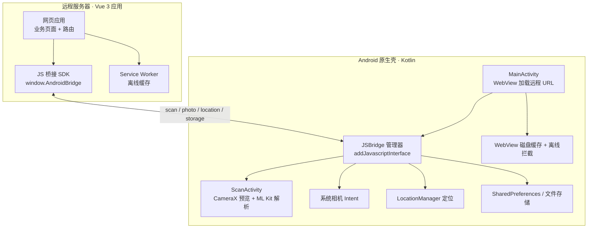
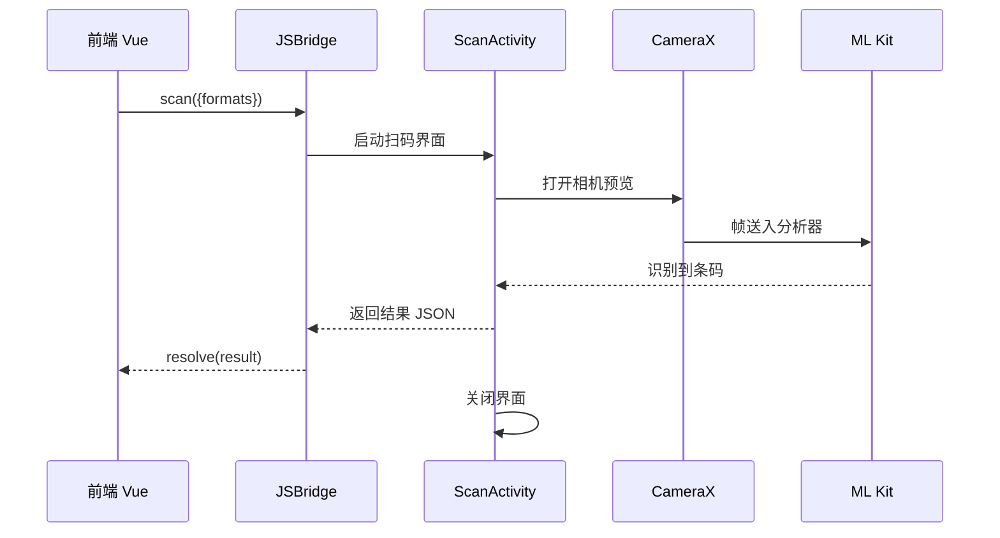
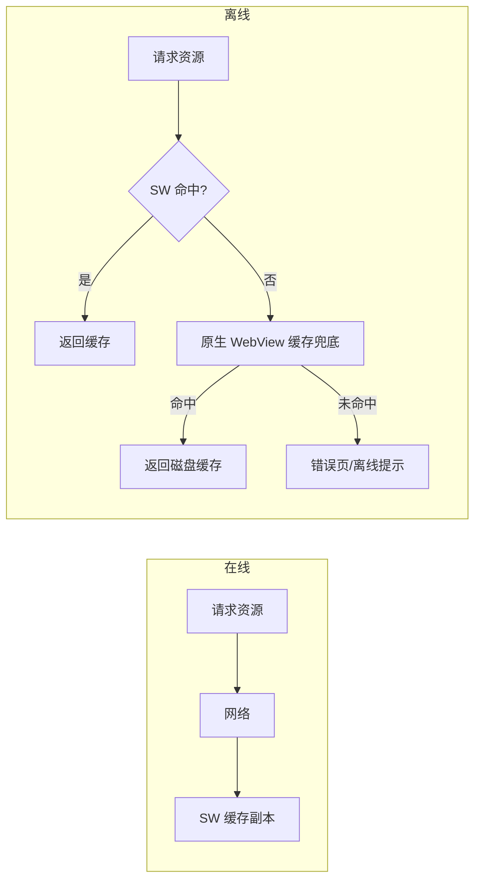

# 纯 WebView 壳 + ML Kit 原生扫码

> 版本：v1.0 ｜ 日期：2026-08-20 ｜ 状态：方案评审稿

---

## 1. 项目概述

### 1.1 项目背景

构建一个 Android 应用，以**远程加载的 HTML 网页**作为主要 UI（以 Vue 3 为主，兼容 React），通过**原生壳 + JSBridge 桥接**提供硬件与系统能力，核心能力为**原生摄像头扫码**（二维码 + 条形码）。

### 1.2 需求确认清单

| 需求项 | 确认结果 |
|--------|---------|
| 目标平台 | 仅 Android |
| UI 形态 | 远程加载网页（浏览器壳模式），前端独立部署 |
| 前端技术栈 | Vue 3 + Vite（兼容 React） |
| URL 配置 | 支持多个地址，在 App 内写死 |
| 原生能力 | 扫码、拍照、定位、本地存储 |
| 离线能力 | 断网时支持离线缓存 |
| 发布渠道 | 国内安卓市场 / 企业内部分发（不依赖 GMS） |

### 1.3 技术选型

| 模块 | 选型 | 说明 |
|------|------|------|
| 原生语言 | Kotlin | Android 官方推荐，代码简洁 |
| 网页容器 | Android WebView | 系统 WebView，随系统更新 |
| 扫码 | CameraX + ML Kit `barcode-scanning` | bundled 模式，**不依赖 GMS**，国内可用 |
| 拍照 | 系统相机 Intent（`ACTION_IMAGE_CAPTURE`） | 零相机界面开发，复用系统相机 |
| 定位 | 原生 `LocationManager`（GPS + 网络） | 不依赖 GMS；如需高精度可后续接入高德/百度 SDK |
| 本地存储 | SharedPreferences + 文件存储 | 轻量 KV + 大文件分离 |
| 前端框架 | Vue 3 + Vite | 打包产物为纯静态资源，部署到任意静态服务器 |
| 离线缓存 | Service Worker（Workbox）+ 原生 WebView 缓存兜底 | 详见第 10 章 |

---

## 2. 总体架构



**核心原则**：UI 全部由前端负责，原生层只提供"能力服务"，通过桥接接口解耦。前端团队可完全独立迭代，原生壳稳定后几乎不再改动。

---

## 3. 项目目录结构

```
e:\app\
├── android/                          # Android 原生壳工程
│   ├── app/
│   │   ├── src/main/
│   │   │   ├── java/com/example/webapp/
│   │   │   │   ├── MainActivity.kt          # 入口，WebView 容器
│   │   │   │   ├── WebViewManager.kt        # WebView 配置、生命周期、缓存策略
│   │   │   │   ├── config/
│   │   │   │   │   └── AppConfig.kt         # 多 URL 配置（写死）
│   │   │   │   ├── bridge/
│   │   │   │   │   ├── JSBridge.kt          # 桥接入口 + 鉴权 + 回调分发
│   │   │   │   │   ├── ScanBridge.kt        # 扫码
│   │   │   │   │   ├── CameraBridge.kt      # 拍照
│   │   │   │   │   ├── LocationBridge.kt    # 定位
│   │   │   │   │   └── StorageBridge.kt     # 本地存储
│   │   │   │   ├── scan/
│   │   │   │   │   ├── ScanActivity.kt      # 扫码界面（相机预览）
│   │   │   │   │   └── BarcodeAnalyzer.kt   # ML Kit 条码解析
│   │   │   │   └── util/
│   │   │   │       └── PermissionHelper.kt  # 动态权限申请
│   │   │   ├── res/
│   │   │   │   ├── layout/
│   │   │   │   │   ├── activity_main.xml
│   │   │   │   │   └── activity_scan.xml
│   │   │   │   ├── values/
│   │   │   │   │   ├── strings.xml
│   │   │   │   │   └── themes.xml
│   │   │   │   └── xml/
│   │   │   │       └── file_paths.xml       # FileProvider 配置（拍照用）
│   │   │   └── AndroidManifest.xml
│   │   └── build.gradle
│   ├── build.gradle
│   └── settings.gradle
│
├── web/                               # Vue 3 前端工程
│   ├── src/
│   │   ├── main.js
│   │   ├── App.vue
│   │   ├── router/                    # 前端路由
│   │   ├── views/                     # 业务页面
│   │   ├── bridge/                    # 桥接 SDK 封装
│   │   │   ├── index.js               # window.AndroidBridge 封装 + Promise 化
│   │   │   └── types.js
│   │   └── utils/
│   ├── public/
│   │   └── sw.js                      # Service Worker（离线缓存）
│   ├── vite.config.js
│   └── package.json
│
└── docs/
    └── 方案设计文档.md                 # 本文档
```

---

## 4. 多 URL 配置设计

### 4.1 需求

- 支持配置**多个远程地址**，在 App 内写死（编译期固定，不依赖后台下发）。
- 支持设置**默认入口 URL** 与**备用 URL 列表**。
- 所有 URL 构成**白名单**，仅白名单内的页面允许调用原生桥接能力（安全要求，见第 12 章）。

### 4.2 配置实现（Kotlin）

```kotlin
// config/AppConfig.kt
object AppConfig {

    /** 默认入口地址（App 启动后加载的第一个页面） */
    const val DEFAULT_URL = "https://app.example.com/index.html"

    /** 备用地址列表：默认地址不可达时按顺序尝试 */
    val FALLBACK_URLS = listOf(
        "https://app2.example.com/index.html",
        "https://backup.example.com/index.html"
    )

    /** URL 白名单：仅这些域名下的页面允许调用原生桥接 */
    val ALLOWED_HOSTS = listOf(
        "app.example.com",
        "app2.example.com",
        "backup.example.com"
    )

    /** 是否允许 HTTP（内网/测试环境用，生产建议仅 HTTPS） */
    const val ALLOW_HTTP = false
}
```

### 4.3 加载策略

1. 启动时加载 `DEFAULT_URL`。
2. 若默认地址加载失败（超时/网络错误），按 `FALLBACK_URLS` 顺序尝试。
3. 加载失败时展示内置错误页，提供"重试"按钮。
4. 前端可通过桥接接口 `getAppInfo()` 获取当前加载的 URL 与 App 版本。

### 4.4 前端多环境支持

前端工程通过 Vite 环境变量区分不同环境的构建产物，但**最终 URL 由 App 决定**，前端无需关心部署在哪个地址：

```js
// web/.env.production
VITE_APP_TITLE=业务应用
```

---

## 5. JSBridge 桥接接口设计

### 5.1 设计原则

- 前端通过 `window.AndroidBridge` 统一访问原生能力。
- 所有异步接口**Promise 化**，原生通过回调返回结果。
- 接口命名语义化，参数与返回值统一为 JSON 对象。
- 原生侧对每个接口做**白名单校验**（当前页面 URL 必须在白名单内）。

### 5.2 接口总览

```js
window.AndroidBridge = {
  // ===== 扫码 =====
  scan(options)            // 打开原生扫码界面，返回识别结果
  // ===== 拍照 =====
  takePhoto(options)       // 调用系统相机拍照，返回图片
  // ===== 定位 =====
  getLocation(options)     // 获取当前定位
  // ===== 本地存储 =====
  setItem(key, value)      // 写入 KV 数据
  getItem(key)             // 读取 KV 数据
  removeItem(key)          // 删除 KV 数据
  clearStorage()           // 清空全部本地数据
  // ===== 应用信息 =====
  getAppInfo()             // 获取 App 版本、当前 URL、设备信息
  closeApp()               // 关闭 App
}
```

### 5.3 接口详细定义

#### 5.3.1 扫码 `scan(options)`

```js
// 调用
const result = await window.AndroidBridge.scan({
  formats: ['QR_CODE', 'EAN_13', 'UPC_A', 'CODE_128'], // 可选，默认全部
  prompt: '请对准二维码',                              // 可选，扫码界面提示文案
  continuous: false                                    // 可选，是否连续扫码
});

// 成功返回
{
  code: 0,
  data: {
    format: 'QR_CODE',        // 条码格式
    rawValue: 'https://...',  // 识别内容
    timestamp: 1724140800000
  }
}

// 用户取消
{ code: 1, message: '用户取消' }
// 无权限
{ code: 2, message: '相机权限被拒绝' }
// 识别失败
{ code: 3, message: '未识别到条码' }
```

#### 5.3.2 拍照 `takePhoto(options)`

```js
const result = await window.AndroidBridge.takePhoto({
  quality: 0.8,          // 可选，压缩质量 0~1
  maxWidth: 1920,        // 可选，最大宽度
  returnBase64: true     // 可选，是否返回 base64（默认 true）
});

// 成功返回
{
  code: 0,
  data: {
    base64: 'data:image/jpeg;base64,...',  // returnBase64=true 时
    filePath: '/data/.../photo.jpg',       // 本地文件路径
    width: 1920,
    height: 1080
  }
}
```

#### 5.3.3 定位 `getLocation(options)`

```js
const result = await window.AndroidBridge.getLocation({
  timeout: 10000,   // 可选，超时毫秒
  highAccuracy: true // 可选，是否高精度（GPS）
});

// 成功返回
{
  code: 0,
  data: {
    latitude: 31.2304,
    longitude: 121.4737,
    accuracy: 25.0,        // 精度（米）
    provider: 'gps',       // gps / network
    timestamp: 1724140800000
  }
}
```

#### 5.3.4 本地存储

```js
await window.AndroidBridge.setItem('user_token', 'abc123');
const token = await window.AndroidBridge.getItem('user_token');
await window.AndroidBridge.removeItem('user_token');
await window.AndroidBridge.clearStorage();
```

> 说明：原生存储与 WebView 自带 `localStorage` 并存。**业务关键数据（token、草稿、配置）建议走原生存储**，更持久、可跨页面共享、可加密；临时数据可用 `localStorage`。

#### 5.3.5 应用信息 `getAppInfo()`

```js
const info = await window.AndroidBridge.getAppInfo();
// {
//   appVersion: '1.0.0',
//   osVersion: '13',
//   deviceModel: 'Xiaomi 14',
//   currentUrl: 'https://app.example.com/index.html',
//   webViewVersion: '120.0.0'
// }
```

### 5.4 原生桥接实现要点（Kotlin）

```kotlin
// bridge/JSBridge.kt
class JSBridge(private val activity: MainActivity) {

    private val callbacks = ConcurrentHashMap<String, (String) -> Unit>()

    @JavascriptInterface
    fun scan(json: String, callbackId: String) {
        if (!isAllowedHost()) { reject(callbackId, "FORBIDDEN"); return }
        callbacks[callbackId] = { resultJson -> evaluateJs(callbackId, resultJson) }
        ScanBridge.start(activity, json, callbacks[callbackId]!!)
    }

    @JavascriptInterface
    fun getLocation(json: String, callbackId: String) {
        if (!isAllowedHost()) { reject(callbackId, "FORBIDDEN"); return }
        LocationBridge.get(activity, json, callbacks[callbackId]!!)
    }

    // ... 其余接口同理

    private fun isAllowedHost(): Boolean {
        val url = activity.webView.url ?: return false
        val host = Uri.parse(url).host ?: return false
        return AppConfig.ALLOWED_HOSTS.contains(host)
    }
}
```

### 5.5 前端 SDK 封装（Promise 化）

```js
// web/src/bridge/index.js
const callNative = (method, params = {}) =>
  new Promise((resolve, reject) => {
    const callbackId = `cb_${Date.now()}_${Math.random().toString(36).slice(2)}`;
    window.__nativeCallbacks = window.__nativeCallbacks || {};
    window.__nativeCallbacks[callbackId] = (res) => {
      delete window.__nativeCallbacks[callbackId];
      res.code === 0 ? resolve(res.data) : reject(new Error(res.message));
    };
    window.AndroidBridge[method](JSON.stringify(params), callbackId);
  });

export const scan = (opts) => callNative('scan', opts);
export const takePhoto = (opts) => callNative('takePhoto', opts);
export const getLocation = (opts) => callNative('getLocation', opts);
export const setItem = (k, v) => callNative('setItem', { key: k, value: v });
export const getItem = (k) => callNative('getItem', { key: k });
export const removeItem = (k) => callNative('removeItem', { key: k });
export const clearStorage = () => callNative('clearStorage');
export const getAppInfo = () => callNative('getAppInfo');
```

---

## 6. 扫码模块设计（核心）

### 6.1 技术选型

| 组件 | 作用 | 说明 |
|------|------|------|
| CameraX | 相机预览、对焦、生命周期 | Android Jetpack 官方库，国内可用 |
| ML Kit `barcode-scanning` | 条码识别 | **bundled 模式**（`com.google.mlkit:barcode-scanning`），不依赖 Google Play Services |

### 6.2 支持的条码格式

ML Kit 支持 20+ 格式，覆盖"二维码 + 条形码"需求：

- **二维码**：QR Code、Data Matrix、PDF417、Aztec
- **一维条码**：EAN-13、EAN-8、UPC-A、UPC-E、Code 39、Code 93、Code 128、ITF
- 可通过 `scan({ formats: [...] })` 按需限制，提升识别速度。

### 6.3 扫码流程



### 6.4 关键实现（Kotlin）

```kotlin
// scan/BarcodeAnalyzer.kt
class BarcodeAnalyzer(
    private val onResult: (Barcode) -> Unit
) : ImageAnalysis.Analyzer {

    private val scanner = BarcodeScanning.getClient(
        BarcodeScannerOptions.Builder()
            .setBarcodeFormats(
                Barcode.FORMAT_QR_CODE,
                Barcode.FORMAT_EAN_13,
                Barcode.FORMAT_UPC_A,
                Barcode.FORMAT_CODE_128
            )
            .build()
    )

    @SuppressLint("UnsafeOptInUsageError")
    override fun analyze(imageProxy: ImageProxy) {
        val mediaImage = imageProxy.image
        if (mediaImage != null) {
            val image = InputImage.fromMediaImage(mediaImage, imageProxy.imageInfo.rotationDegrees)
            scanner.process(image)
                .addOnSuccessListener { barcodes ->
                    barcodes.firstOrNull()?.let { b ->
                        onResult(b)
                        imageProxy.close()
                    }
                }
                .addOnCompleteListener { imageProxy.close() }
        }
    }
}
```

### 6.5 扫码界面交互

- 全屏相机预览 + 半透明取景框（对准提示）。
- 顶部提示文案（可配置）、底部"关闭"按钮。
- 识别成功后：震动反馈 + 短暂高亮 → 返回结果。
- 支持连续扫码模式（`continuous: true`），识别后不关闭，继续下一次。

---

## 7. 拍照模块设计

### 7.1 技术选型

采用**系统相机 Intent**（`ACTION_IMAGE_CAPTURE`），复用系统相机界面，零相机 UI 开发成本。

### 7.2 流程

1. 前端调用 `takePhoto()`。
2. 原生创建临时文件（FileProvider 暴露 URI），启动系统相机。
3. 拍照完成后读取图片，按参数压缩（质量/最大宽度）。
4. 返回 base64 或本地文件路径给前端。

### 7.3 关键点

- 需要配置 `FileProvider`（`res/xml/file_paths.xml`）。
- 系统相机 Intent 方式**不需要 CAMERA 权限**（相机界面由系统相机 App 提供）。
- 大图需压缩后再转 base64，避免内存溢出（OOM）。

---

## 8. 定位模块设计

### 8.1 技术选型

- 基础方案：原生 `LocationManager`（GPS + 网络定位），**不依赖 GMS**，国内可用。
- 如需高精度/逆地理编码（地址文字），后续可接入高德/百度定位 SDK（企业内网也可自建）。

### 8.2 流程

1. 前端调用 `getLocation()`。
2. 原生检查定位权限，动态申请。
3. `LocationManager` 获取最新位置（GPS 优先，网络兜底）。
4. 返回经纬度 + 精度 + 来源。

### 8.3 关键点

- 需要 `ACCESS_FINE_LOCATION` / `ACCESS_COARSE_LOCATION` 权限。
- 需在 `onResume` 注册监听、`onPause` 注销，避免耗电。
- 室内场景 GPS 可能无信号，需网络定位兜底。

---

## 9. 本地存储模块设计

### 9.1 技术选型

| 数据类型 | 存储方案 | 说明 |
|---------|---------|------|
| 轻量 KV（token、配置、草稿） | SharedPreferences | 简单、快、跨页面共享 |
| 大文件（图片、日志） | 应用私有目录文件 | `context.filesDir` |
| 敏感数据（可选） | EncryptedSharedPreferences | AndroidX Security 库，加密存储 |

### 9.2 接口映射

| 前端接口 | 原生实现 |
|---------|---------|
| `setItem(key, value)` | SharedPreferences `putString` |
| `getItem(key)` | SharedPreferences `getString` |
| `removeItem(key)` | SharedPreferences `remove` |
| `clearStorage()` | SharedPreferences `clear` |

### 9.3 与 WebView localStorage 的关系

- **原生存储**：持久、跨页面共享、可加密、不随 WebView 数据清除而丢失。
- **localStorage**：WebView 自带，简单，但清除 WebView 数据会丢失。
- **建议**：业务关键数据走原生存储；临时数据用 localStorage。

---

## 10. 离线缓存方案

### 10.1 总体策略

采用**前端 Service Worker 为主 + 原生 WebView 缓存兜底**的双层方案。



### 10.2 前端 Service Worker（推荐，需 HTTPS）

- 使用 **Workbox** 在构建时生成 Service Worker。
- **预缓存（Precache）**：App Shell（HTML、JS、CSS、图标），安装时缓存，保证首屏离线可用。
- **运行时缓存（Runtime）**：图片、API 响应按策略缓存（`NetworkFirst` / `StaleWhileRevalidate`）。
- 断网时 SW 拦截请求，返回缓存内容。

```js
// web/public/sw.js（Workbox 生成）
importScripts('https://storage.googleapis.com/workbox-cdn/releases/7.0.0/workbox-sw.js');

workbox.precaching.precacheAndRoute(self.__WB_MANIFEST);

// API 请求：网络优先，失败回退缓存
workbox.routing.registerRoute(
  ({ url }) => url.pathname.startsWith('/api/'),
  new workbox.strategies.NetworkFirst({
    cacheName: 'api-cache',
    plugins: [new workbox.expiration.ExpirationPlugin({ maxEntries: 100 })]
  })
);
```

> **前提条件**：Service Worker 仅在 **HTTPS**（或 localhost）下可注册。若远程部署在 HTTP 内网，SW 不可用，需依赖原生层缓存（见 10.3）。

### 10.3 原生 WebView 缓存兜底

- 启用 WebView 磁盘缓存：`settings.cacheMode = LOAD_DEFAULT`。
- 自定义 `WebViewClient.shouldInterceptRequest`：断网时拦截请求，返回磁盘缓存或本地兜底资源。
- 断网检测：`ConnectivityManager` 监听网络状态，断网时前端收到事件，展示离线提示。

```kotlin
// WebViewManager.kt 关键配置
webView.settings.apply {
    cacheMode = WebSettings.LOAD_DEFAULT
    domStorageEnabled = true
    databaseEnabled = true
    setAppCacheEnabled(true)
    setAppCachePath(context.cacheDir.path)
}
```

### 10.4 离线兜底页面

- 首次加载失败或断网且无缓存时，展示内置离线页（HTML 资源打包进 App）。
- 提供"重试"按钮，网络恢复后重新加载。

---

## 11. 权限清单

| 权限 | 用途 | 申请时机 |
|------|------|---------|
| `INTERNET` | 加载远程网页 | 安装时（普通权限） |
| `CAMERA` | 扫码（CameraX 自建界面） | 首次调用 `scan()` 时动态申请 |
| `ACCESS_FINE_LOCATION` | 高精度定位 | 首次调用 `getLocation()` 时动态申请 |
| `ACCESS_COARSE_LOCATION` | 网络定位 | 同上 |
| `WRITE_EXTERNAL_STORAGE` | 拍照文件（Android 10 以下） | 按需（Android 10+ 用分区存储，无需此权限） |

> 拍照走系统相机 Intent，**不需要 CAMERA 权限**；扫码自建相机界面，**需要 CAMERA 权限**。

---

## 12. 安全设计

### 12.1 URL 白名单

- 仅 `AppConfig.ALLOWED_HOSTS` 内的页面允许调用原生桥接。
- 每次桥接调用前校验当前页面 host，防止 XSS 或恶意页面劫持桥接能力。

### 12.2 传输安全

- 生产环境强制 HTTPS（`ALLOW_HTTP = false`）。
- 前端资源启用 CSP（Content-Security-Policy），限制脚本来源。

### 12.3 桥接最小权限

- 只暴露必要接口，不暴露文件系统、shell、安装应用等危险能力。
- 存储接口限制 key 长度与 value 大小，防止滥用。

### 12.4 数据安全

- 敏感数据（token 等）使用 EncryptedSharedPreferences 加密存储。
- 拍照、扫码结果不落盘（除非前端明确要求）。

---

## 13. 兼容性与性能

### 13.1 WebView 兼容性

- 国内 ROM 系统 WebView 版本碎片化，建议**最低支持 Android 8.0（API 26）**。
- Vue 3 需要较新 WebView（Chrome 内核 60+），Android 8+ 基本满足。
- 建议在主流机型（华为、小米、OPPO、vivo、荣耀）做兼容测试矩阵。

### 13.2 性能优化

- 前端资源压缩、按路由懒加载。
- 图片走 CDN + 懒加载。
- 扫码分析器控制帧率（`setTargetFrameRate`），降低功耗。
- 大图拍照后压缩再传 base64，避免 OOM。

---

## 14. 维护与迭代策略

| 部分 | 维护成本 | 迭代方式 |
|------|---------|---------|
| 前端（Vue） | 低 | 独立部署到服务器，改完即生效，无需发版 |
| 原生壳 | 低 | 代码量小，稳定后几乎不动；随 Android SDK 升级 |
| 扫码模块 | 低 | ML Kit bundled 模式，库自带，无需维护相机逻辑 |
| 多 URL 配置 | 低 | 写死配置，改配置需发版（如需热更新可后续接后台下发） |

**关键结论**：
- 前端团队可完全独立迭代，业务需求响应最快。
- 原生壳是一次性投入，后续维护集中在 Android 系统升级适配。
- 新增原生能力只需在桥接层加一个接口，前端同步封装即可。

---

## 15. 开发计划

| 阶段 | 内容 | 产出 | 预估 |
|------|------|------|------|
| P0 | 原生壳 + WebView + 多 URL 配置 + 错误页 | 可加载远程页面的壳 | 2~3 天 |
| P1 | JSBridge 框架 + 扫码模块 | 扫码可用 | 3~4 天 |
| P2 | 拍照、定位、本地存储 | 桥接能力齐全 | 2~3 天 |
| P3 | 离线缓存（SW + 原生兜底） | 断网可用 | 2~3 天 |
| P4 | 安全加固 + 兼容性测试 | 稳定版本 | 2~3 天 |
| P5 | 打包签名 + 分发 | 可安装 APK | 1 天 |

> 合计约 2~3 周（单人全职），前端业务页面开发另计。

---

## 16. 风险与对策

| 风险 | 影响 | 对策 |
|------|------|------|
| 国内 WebView 版本碎片化 | 页面渲染差异 | 最低支持 Android 8+，兼容测试矩阵 |
| 远程页面为 HTTP 内网 | SW 离线缓存不可用 | 原生 WebView 缓存兜底 + 离线页 |
| 定位精度不足（室内） | 定位不准 | GPS + 网络双源，必要时接高德/百度 SDK |
| 桥接被 XSS 劫持 | 数据泄露 | URL 白名单 + 桥接鉴权 + CSP |
| 大图 base64 内存溢出 | 崩溃 | 压缩 + 限制尺寸 + 可选文件路径返回 |

---

## 17. 待确认事项

| 事项 | 说明 | 影响 |
|------|------|------|
| 远程服务器是否 HTTPS | 决定 SW 离线缓存是否可用 | 高 |
| 定位是否需要地址文字（逆地理编码） | 决定是否接第三方定位 SDK | 中 |
| 是否需要推送通知 | 需额外接入厂商推送 | 中 |
| 是否需要多页面/多标签 | 当前按单页面应用设计 | 低 |
| 最低支持 Android 版本 | 默认 Android 8.0 | 中 |